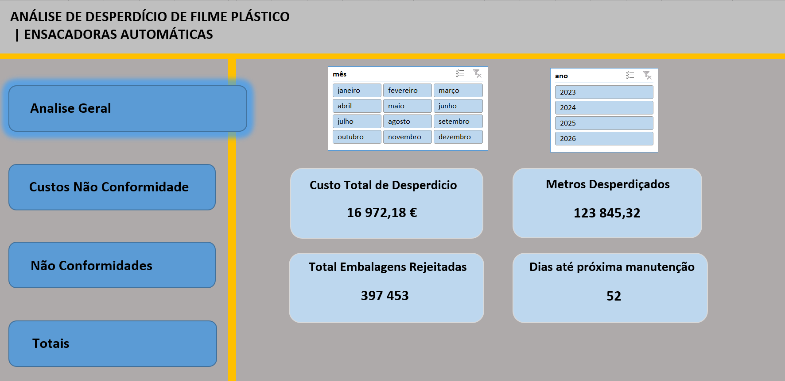
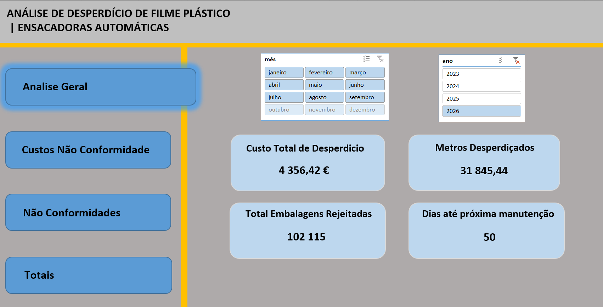
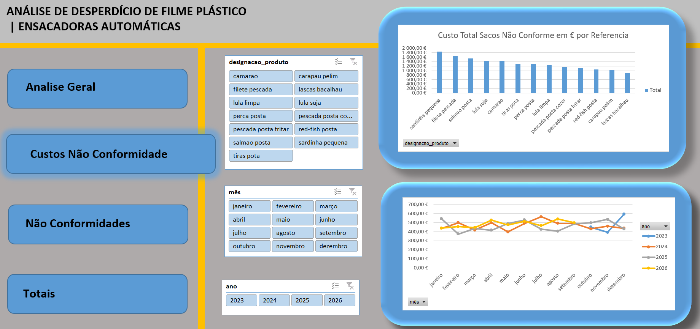
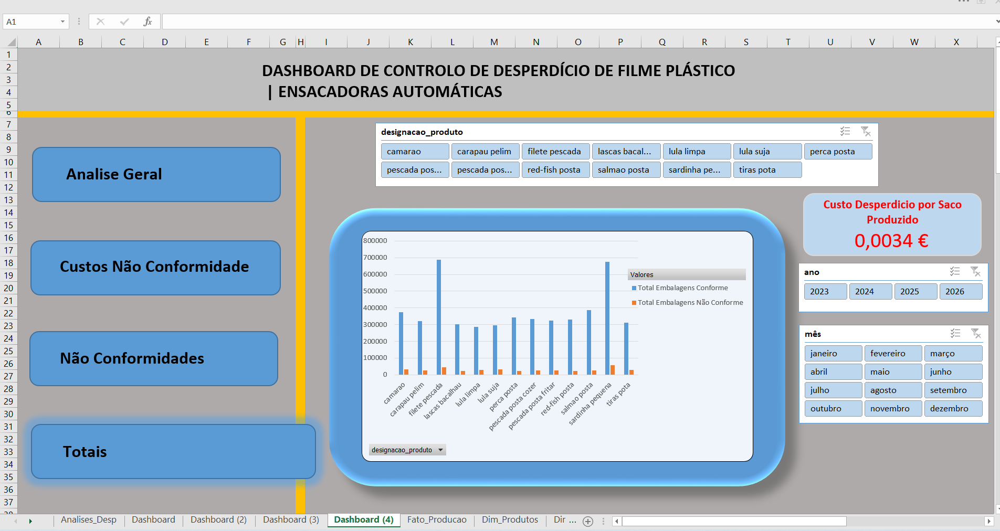
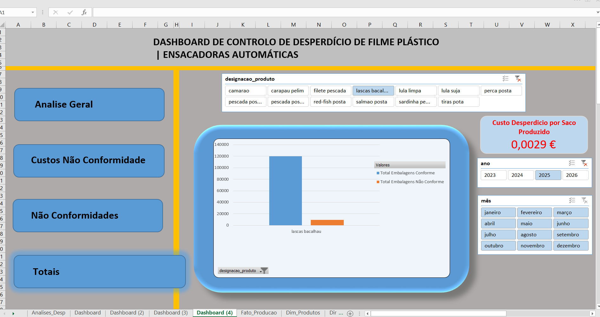
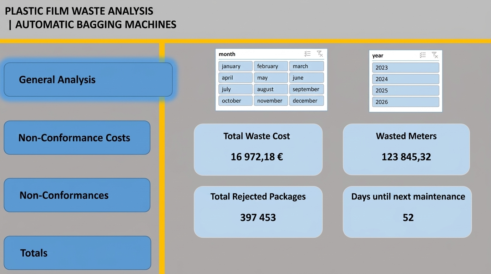
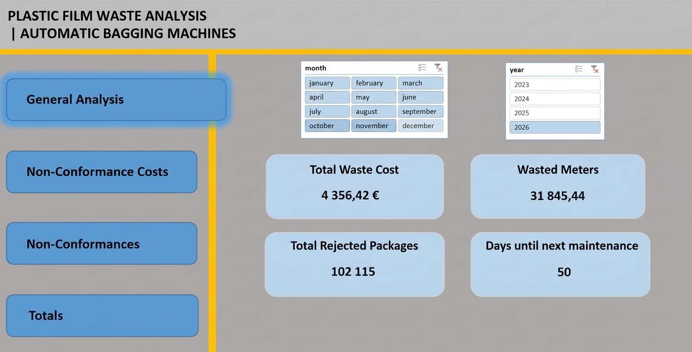
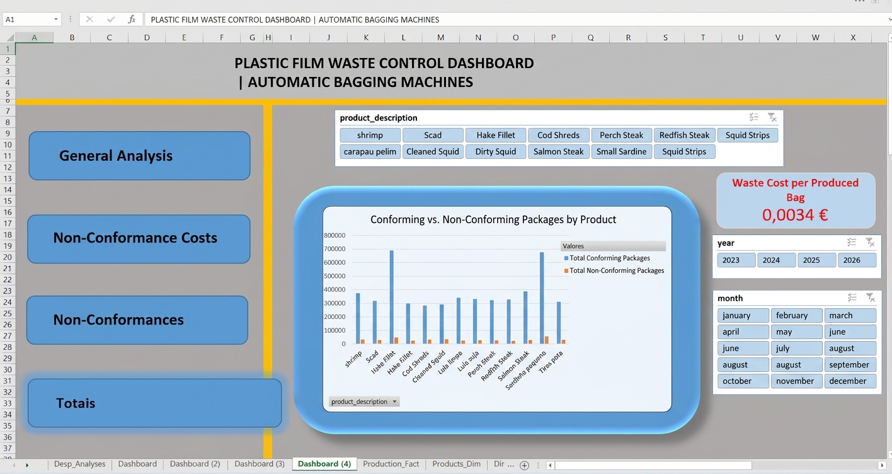
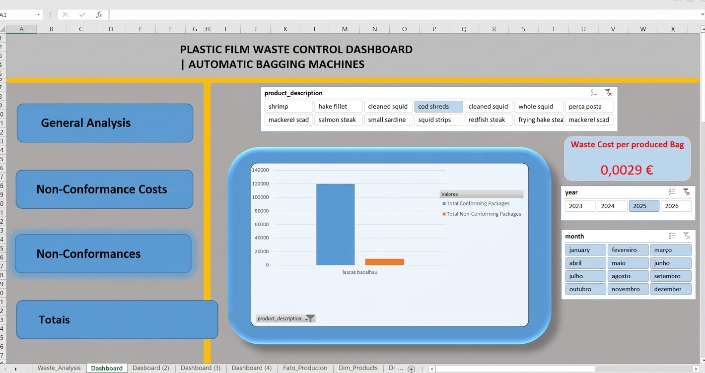

# PT

# Industrial VFFS Film Waste & Maintenance Analytics Dashboard

## Resumo do Projeto
Modelo analítico e executivo desenvolvido em **Microsoft Excel** para monitorizar, auditar e reduzir o desperdício de filme plástico e taxas de não-conformidade em máquinas ensacadoras automáticas (VFFS) no setor alimentar. O projeto cruza dados operacionais de produção com o comportamento mecânico da linha para otimizar os ciclos de manutenção preventiva.

---

## Principais KPIs & Métricas Desenvolvidas
* **Custo Total de Desperdício (€) & Metros (m):** Quantificação financeira e volumétrica do filme rejeitado.
* **Curva de Degradação Pós-Revisão:** Análise do impacto temporal do desgaste mecânico no aumento de desperdício após a última intervenção.
* **Duração Média do Ciclo de Manutenção:** Isolamento matemático dos ciclos operacionais reais (~50-60 dias), ignorando valores nulos para evitar distorções estatísticas.
* **Custo de Desperdício por Saco Produzido (€/un):** Indicador de eficiência unitária que mede o acréscimo de custo por embalagem fabricada devido a não-conformidades.

---

## Pré-visualização do Dashboard

---

## Stack Tecnológica & Metodologia
* **Ferramenta:** Microsoft Excel (Estrutura relacional plana, Tabelas Dinâmicas, Slicers interativos e Funções Lógicas Avançadas).
* **Modo de Apresentação:** Interface otimizada em estilo "App" (ocultação de grelhas, barras de fórmulas e cabeçalhos para foco total na experiência do utilizador).
* **Tratamento de Dados:** Gestão de células vazias e tratamento de erros (`SE`, `MÉDIA.SE`) para garantir rigor estatístico nos cálculos dinâmicos.

---

## Estrutura do Repositório
* `Projeto_Desperdicio_Ensacadora.xlsx`: O ficheiro Excel completo com o modelo analítico e interativo.
* `imagens/`: Pasta com as imagens utilizadas na documentação.

# EN

# Industrial VFFS Film Waste & Maintenance Analytics Dashboard

## Project Summary
Executive analytical model developed in Microsoft Excel to monitor, audit, and reduce plastic film waste and non-conformance rates in automated vertical form, fill, and seal (VFFS) packaging machines in the food sector. The project cross-references operational production data with the mechanical behavior of the line to optimize preventive maintenance cycles.

---

## Key KPIs & Developed Metrics
* **Total Waste Cost (€) & Meters (m):** Financial and volumetric quantification of the rejected film.

* **Post-Revision Degradation Curve:** Analysis of the temporal impact of mechanical wear on the increase of waste following the last intervention.

* **Average Maintenance Cycle Duration:** Mathematical isolation of real operational cycles (~50-60 days), ignoring null values to prevent statistical distortions.

* **Waste Cost per Produced Bag (€/unit):** Unit efficiency indicator measuring the cost increase per manufactured package due to non-conformities.

---

## Dashboard Preview

---

## Tech Stack & Methodology 
* **Tool:** Microsoft Excel (Flat relational structure, Pivot Tables, interactive Slicers, and Advanced Logical Functions).

* **Presentation Mode:** Optimized "App-style" interface (hiding gridlines, formula bars, and headers for total focus on the user experience).

* **Data Treatment:** Management of empty cells and error handling (IF, AVERAGEIF) to ensure statistical rigor in dynamic calculations.

---

## Repository Structure
* **Projeto_Desperdicio_Ensacadora.xlsx**  
The complete Excel file containing the analytical and interactive model.

* **imagens/:**  
Folder containing the images used in the documentation.
